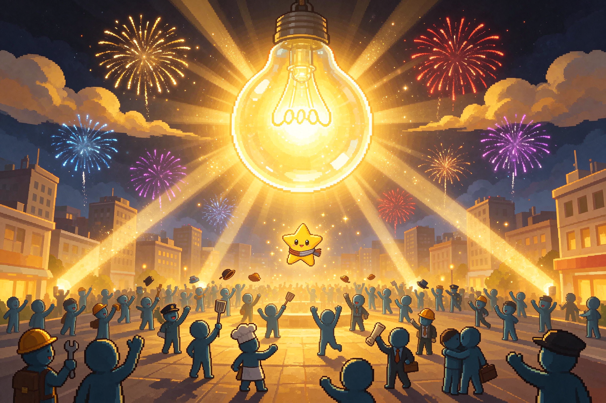
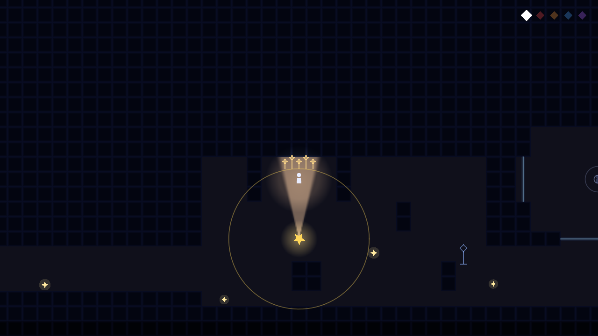
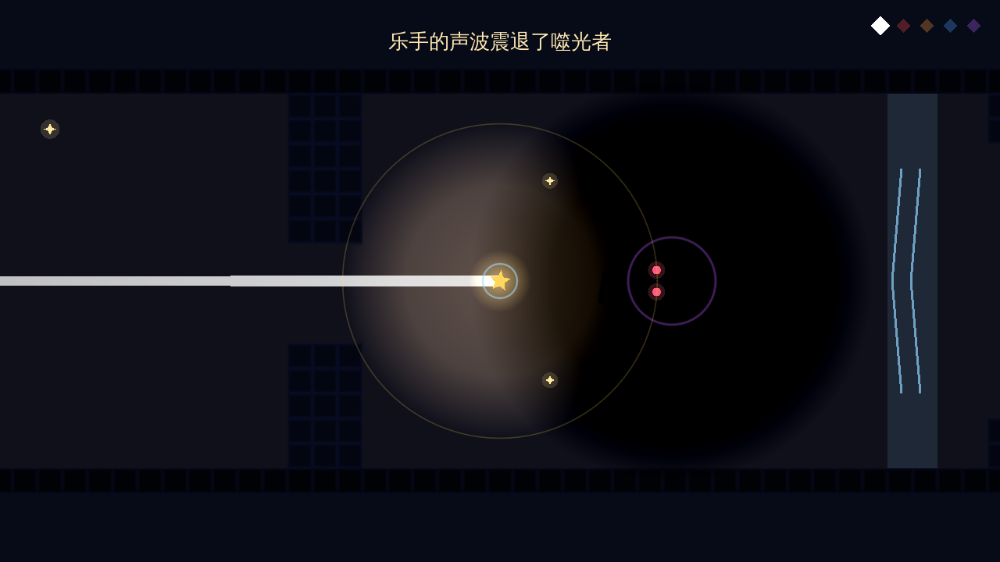
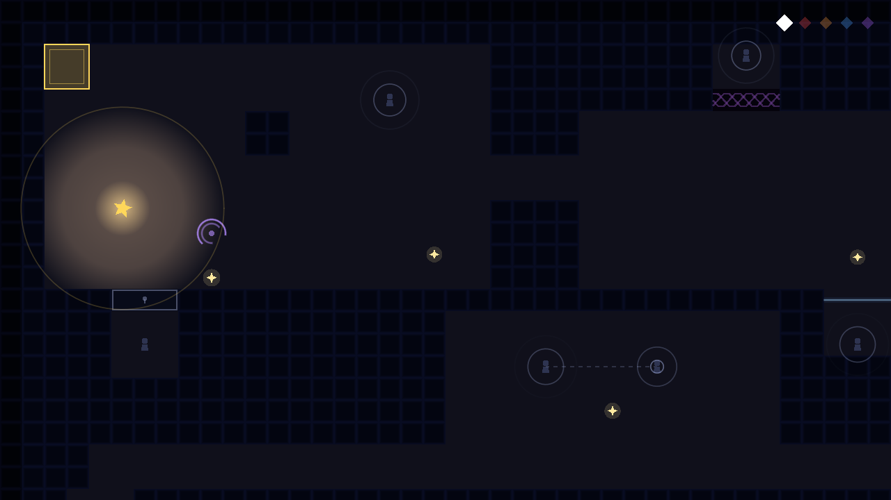

# 星愿：撞碎长夜

**StarWish — Smash the Long Night**

一颗星星，飞进一座熄了灯的城市。

俯视角 2D 像素叙事跑酷 / 潜行游戏。你是夜空里最后一点光，要在全城的黑暗里照亮并唤醒沉睡的人，然后从追来的噬光者嘴里逃出去。

Godot 4.7.2 · GDScript · 五章 + 终章 · 双结局 · 30 项自动化测试



---

## 游戏简介

城市的灯一盏一盏灭了。你是一颗还没放弃的星星。

每一章都是一段横穿黑暗的路：地上躺着睡着了的人，你把光打在他们身上，他们就会醒过来，然后各自用手艺帮你一次——守夜人给你一层护盾，园丁让藤蔓开花，医生把你的光补回来，画家给你开一扇门，锁匠把铁门打开，矿工在赛道里挖出一条隧道，科学家在墙里凿一个虫洞，乐手用声波把追来的东西震退。

代价是：你只有那么大一点光。走得越远，光越薄。照亮别人，自己也离熄灭更近一步。

最后一章，噬光者追了上来。你要么跑到逃离点，要么回头把它撞碎。

---

## 画面

| 聚光与苏醒 | 声波击退 |
|---|---|
|  |  |



---

## 核心玩法

**光有两个挡位，随时切换。**

- **散射光**：一个圆，半径 90–220 px，随着你的剩余光量变大变小。用来一趟照亮一屋子人。
- **聚光**：一束 16° 半角、射程 2.2 倍的锥形光。照得更远，但只能照一个人。撞到镜子会**反射一次**，反射出去的光一样能救人——有些房间只能靠这个解法过去。

**光会衰减。** 每照亮一个人、每过一秒，光都在变少。补给星屑散落在路上，撞一下就捡。光归零，人就灭了。

**撞碎影子。** 黑暗里游着影鬼，红眼睛。你可以直接撞上去把它撞碎——有定帧、有火花、有连击音高往上走的那一下爽感。但撞的时机和角度不对，碎的就是你。

**游戏界面几乎不写字。** 所有按钮都是画出来的图形：`▶ ↻ ⚙ ⌂ ✕`。标题页会跟着鼠标晃——鼠标偏到左边，画面就往右边挪，远的层挪得少、近的层挪得多，用阻尼弹簧收，会先冲过头再荡回来。

| 难度 | 变化 |
|---|---|
| 微光级 | 标准体验 |
| 长夜级 | 补给只留影鬼附近的；救人不再回光 |
| 永夜级 | 光衰减 ×1.7；每只影鬼旁边多生一只 |

---

## 章节

| 章 | 场景 | 学到的机制 |
|---|---|---|
| ch0 | 郊区，第一天夜里 | 移动、撞碎影鬼、面包屑 |
| ch1 | 镜子房与玻璃温室 | 聚光、镜子反射、栅栏透光 |
| ch2 | 向导的拐角 | 传声、远距离救援 |
| ch3 | 邮差房、铁门与矿道 | 锁匠、铁门、隧道 |
| ch4 | 城市，陷阱遍地 | 黑洞、流星、加速带、软垫 |
| 终章 | 六折 S 形迷宫 | boss 追逐、掉头冲刺、双结局 |

**两个结局。** 十二个人全部唤醒、并且跑到逃离点 —— 真结局（三页四格漫画 + 一张 CG）。少一个人就是普通结局：城市的灯被一栋一栋吸走。把噬光者直接撞碎也算到达终点。

---

## 技术栈

- **引擎**：Godot 4.7.2，GL Compatibility 渲染后端（能导出 Web）
- **语言**：GDScript，四个 autoload：`Save` / `Game` / `Audio` / `Controls`
- **关卡**：不是手摆的。`tools/*_map.txt` 里是 ASCII 地图，`tools/build_test_levels.gd` 把它编译成 `.tscn`。场景是**生成物**。
- **美术**：位图 + 程序生成图集（`tools/tile_art.py` 画墙、地面，16 种四邻掩码 × 4 个变体）。所有贴图都有代码兜底——图没了会退化成几何绘制，不崩，只是变丑。
- **音频**：33 个音效（10 个采样 + 23 个用 `tools/sfx_synth.py` 合成的）＋ 9 首 BGM，首尾交叉淡化后标准化到 −16 LUFS，可以无缝循环。
- **字体**：文泉驿正黑（CJK）
- **测试**：30 个 headless 场景测试，覆盖碰撞、光照、boss 状态机、五章通关、双结局、音频、设置、触屏布局、流程切换

---

## 运行

**需要 Godot 4.7.2**（[下载](https://godotengine.org/download)）。

```bash
git clone https://github.com/HH-567/starwish.git
cd starwish
godot --path .          # 直接跑
```

导出 Web（`export_presets.cfg` 里已配好）：

```bash
godot --headless --path . --export-release "Web" build/index.html
```

> 仓库里不含 `build/` 导出产物和 `.godot/` 导入缓存，这两样都要本地生成。

---

## 开发

关卡改了要重建，否则测试跑的是旧场景（这个坑踩过好几次，会误判成代码坏了）：

```bash
godot --headless --path . --import                          # 改了脚本/资源后
godot --headless --path . 'res://tools/build_test_levels.tscn'  # 改了地图后（必须）
godot --headless --path . --fixed-fps 60 'res://tests/test_ch1.tscn'
```

`tools/dev.sh` 里有 shell 快捷函数：`gd_import` / `gd_build` / `gd_test <名字>` / `gd_all` / `gd_export` / `gd_shots <章>`。

**约定**（改代码前请读）：

- 画面上不写字（制作名单除外），用图形表达
- 没有必救的人，出口永远开着，没有屏内文字提示
- 关卡只改 `tools/*.txt`，`scenes/levels/*.tscn` 是生成物，手改会被覆盖
- 改动后跑全量测试，测试不过不提交

游戏内调试快捷键：`R` 回检查点 · `F2` 光衰减开关 · `F3` 调试面板 · `F5` 清空本章进度 · **`F6` 一键进真结局 boss 战**

---

## 目录结构

```
starwish/
├─ project.godot            autoload: Save / Game / Audio / Controls
├─ export_presets.cfg       Web + Windows 导出配置
├─ scenes/
│  ├─ levels/               ★ 生成物，由 tools/*_map.txt 编译（ch0..ch4、finale、chase）
│  ├─ entities/             npc / enemy / boss / mirror / bars / iron_door …
│  └─ ui/                   title / hud / pause_menu / settings / credits / ending
├─ scripts/
│  ├─ autoload/             存档、全局游戏状态、音频、输入
│  ├─ entities/             玩家、星星光、NPC、影鬼、噬光者、镜子、铁门…
│  ├─ levels/               chapter.gd（章节基类）、finale.gd
│  ├─ fx/                   碎裂、溶解、碎片、冲击环、光照、boss 特效
│  └─ ui/                   全图形 UI 与自绘图标
├─ tools/                   关卡源文件 + 构建器 + 诊断探针 + 截图工具
├─ tests/                   30 个 headless 测试
├─ assets/art/              位图美术，按 22 个类别分目录
├─ audio/                   33 个音效 + bgm/ 9 首
└─ docs/                    设计 / 美术 / 音频 / 踩坑文档
```

`tools/` 里有几个值得一说的东西：`probe_maze.gd` 验终章迷宫可解性并数拐弯，`probe_mirror.gd` 打印镜子反射方向（别猜，用探针看），`shots_tour.tscn` 自动把星星挪到这一章每个 NPC 和机关旁边各录一组帧，`level_report.py` 生成本章俯视图和补给密度报告。

---

## 文档

| 文档 | 内容 |
|---|---|
| [`docs/HANDOFF.md`](docs/HANDOFF.md) | **接手必读**：环境、五条命令、目录、17 条踩坑清单、待办 |
| [`docs/state-machines.md`](docs/state-machines.md) | 所有状态机（玩家 / 敌人 / boss / 章节流程） |
| [`docs/level-data-format.md`](docs/level-data-format.md) | ASCII 地图字符表 |
| [`docs/art-spec.md`](docs/art-spec.md) | 22 类美术资源规格与尺寸 |
| [`docs/audio-brief.md`](docs/audio-brief.md) | 33 个音效的用途清单与音频规格 |
| [`docs/boss-maze-status.md`](docs/boss-maze-status.md) | 终章迷宫的演进与探针结论 |
| [`docs/delivery.md`](docs/delivery.md) | 交付清单 |

---

## 已知问题

- 触屏与手柄布局有测试覆盖，但**没有真机手感验证**
- 难度切换要重进本章才生效（有意为之，避免中途重排关卡）
- 普通结局的城市剪影是程序画的占位，没有专门素材
- 散射光开阴影后在 Web 上的帧率没实测过

---

## 关于

Game Jam 作品。引擎 Godot 4.7.2，代码、关卡数据和美术资源全部开源。

关卡是 ASCII 地图编译出来的，场景文件一律是生成物；美术按 `docs/art-spec.md` 的规格产出；音效用脚本合成，BGM 首尾做交叉淡化，所以能无缝循环。

欢迎提 Issue 或接手完善。
