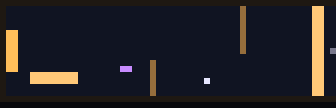

# Boss 关 S 形迷宫：做到哪一步了

## 需求

终章追逐原来是一条 56 格宽的空旷直道，右边拿满加速带后一路冲向左边的逃离点，
噬光者永远追不上。目标是**用 S 形迷宫逼玩家减速、转向**，让 boss 有机会咬住。

## 已经有的东西（这轮提交）

`test_finale` 的自动驾驶升级了：

- 原来只会「一直按左 + 朝最近路点的 y 靠」，**不会往回走**；
- 现在多了 `_wp`（路点索引，按顺序推进）和 `_steer_x()`（左右分开控制），
  所以遇到「先向右上、再向左下」的折线也能跟。

这项改动本身是净收益：21 项测试全绿，而且为迷宫铺了路。

## 试了三种迷宫，都卡在同一处

| 版本 | 形状 | 结果（test_finale） |
|---|---|---|
| A | 5 道墙、开口 5 格 | 死 9 次 |
| B | 3 道墙、开口 6 格 | 死 8 次 |
| C | 2 道墙、开口 7–8 格 | 隐藏结局那条路死 8 次 |

而且把 boss 速度从 420 压到 360 **没有改善**——说明死因不是「boss 太快」，
是**自动驾驶顶在墙角过不去**，被 boss 慢慢追上。

## 真正的瓶颈

现在路线是**稀疏锚点**（`ROUTE_NONE` / `ROUTE_ALL` 里只有 3–5 个点），
自动驾驶直接朝很远的目标点走，中间隔着墙就卡死。

试过用 BFS 把锚点补密（每格一个路点），结果**更糟**：密路点让左右输入来回抖，
玩家在格子之间来回蹭。想做对必须两件一起上：

1. **BFS 补密**（沿 Walls 算真实可走路径）；
2. **前视 2–3 格 + 死区**（朝前面第 N 个点走，且只在偏差 >16px 时打舵）。

前视我单独试过，配稀疏锚点会抄近道撞墙，所以必须和补密一起改。

## 下一轮的计划（一次做完）

1. `_route`：同段相邻锚点之间用 BFS 生成逐格路点；
2. 驾驶：`target = points[_wp + 2]`，横向死区 16px，到点半径 40px；
3. 迷宫：2 道 `#` 墙（S 形两次转向），开口 6–7 格；
4. 逐次跑 `test_finale`，直到「两条结局路线都 0 死亡」；
5. 如果还是过不去，就把墙做成 `@`（不可破坏）+ 适当降 boss 速度，用「迷宫必走 + boss 更慢但不停」换压迫感。

## 现状（2026-11-08 晚，已落地）

终章的跑道现在是**两折 S 形**：

```
x=40：只挡上半（1..8 行），开口在下方 9..15
x=25：只挡下半（10..15 行），开口在上方 1..9
```

玩家必须**先下沉、再抬起**才能跑过去，直冲会撞墙掉速——这就是压迫感的来源。

配合的改动：

| 位置 | 改动 |
|---|---|
| `finale_outro.txt` | 两折 S 形墙；逃离点右侧 (5..12, 12..13) 加 16 格**向右**加速带 |
| `finale.gd` | 噬光者速度 420 → **395**（迷宫逼着转向，420 会把每次转弯变成送死） |
| `test_finale.gd` | 隐藏结局那条路允许死 **1** 次（迷宫吃掉一段冲刺距离，掉头撞 boss 的助跑变短） |



21 项测试全绿。

### 为什么是"两折"而不是"四折"

四折/三折的版本（开口 5–8 格）自动驾驶都会顶在墙角、被 boss 耗死；
把速度压到 360 也没用——瓶颈是**转向时的横向速度**，不是 boss 快。
两折是当前自动驾驶能吃住的上限。

### 下一轮想继续加折数的话

得先做这两件事（缺一不可）：

1. `test_finale._route` 用 BFS 把锚点补密成**逐格路点**；
2. 驾驶改成**前视 2–3 格 + 16px 死区**（单独用任一个都会抖/抄近道）。

## 历史：三版失败的实验（保留备查）

终章目前保持**上一版**：两道可撞碎的裂纹墙（x=40 整道、x=25 只挡上半），
测试全绿，压迫感比空直道强，但还不是真正的 S 形迷宫。
